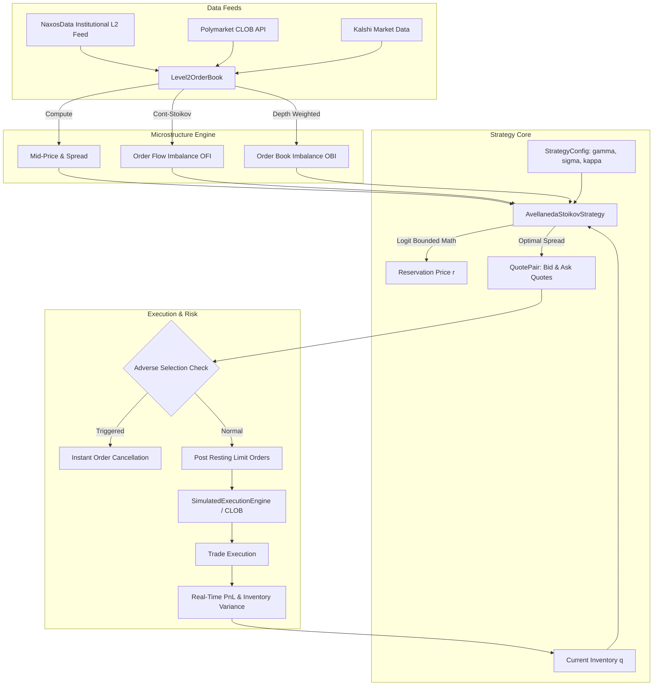

# Polymarket & Kalshi Market Maker Bot 📊

[](https://opensource.org/licenses/MIT)
[](https://www.python.org/)
[](tests/)
[](https://naxosdata.com)
[](#)

> **Production-grade quantitative market making engine for binary prediction markets (Polymarket and Kalshi). Implements the Avellaneda-Stoikov (2008) model adapted for bounded probability outcomes ($0.00 - $1.00), Bernoulli variance dynamics, real-time Order Flow Imbalance (OFI), and toxic adverse selection defense.**

---

## 📑 Table of Contents

- [Overview](#-overview)
- [Keywords & Target Use-Cases](#-keywords--target-use-cases)
- [Mathematical Framework](#-mathematical-framework)
  - [1. Bounded Probability Indifference Pricing (Logit-Space)](#1-bounded-probability-indifference-pricing-logit-space)
  - [2. Bernoulli Instantaneous Variance](#2-bernoulli-instantaneous-variance)
  - [3. Optimal Bid-Ask Spread](#3-optimal-bid-ask-spread)
  - [4. Order Flow Imbalance (OFI) & Microstructure](#4-order-flow-imbalance-ofi--microstructure)
- [Architecture](#-architecture)
- [Installation](#-installation)
- [Quickstart & Demo](#-quickstart--demo)
- [CLI Reference](#-cli-reference)
- [Python SDK Integration](#-python-sdk-integration)
- [NaxosData API Integration](#-naxosdata-api-integration)
- [Risk Management & Safety Controls](#-risk-management--safety-controls)
- [Testing](#-testing)
- [License](#-license)

---

## ⚡ Overview

Market making on binary prediction markets (such as **Polymarket** on Polygon and **Kalshi** CFTC-regulated event contracts) introduces microstructural dynamics distinct from traditional equity or perpetual futures markets:

1. **Strict Probability Bounds**: Contract outcomes settle strictly at either **$1.00 (YES)** or **$0.00 (NO)**. Unbounded linear inventory skew formulas break down near boundaries.
2. **State-Dependent Variance**: Instantaneous price volatility is not constant; it follows Bernoulli variance $p(1 - p)$, peaking at $p = 0.50$ and collapsing as $p \to 0$ or $p \to 1$.
3. **Informed Order Flow & Toxic Flow**: Prediction markets feature sudden news shocks and whale orders. The bot incorporates continuous **Order Flow Imbalance (OFI)** and **Adverse Selection Cancellation** to pull resting limit orders before being adversely filled.

This repository provides an institutional, battle-tested Python framework incorporating continuous Level 2 book ingestion, Avellaneda-Stoikov pricing, and paper-trading execution.

---

## 🔍 Keywords & Target Use-Cases

- **polymarket market maker**
- **kalshi market making bot**
- **avellaneda stoikov polymarket**
- **prediction market market making**
- **order flow imbalance**
- High-frequency prediction market liquidity provision
- Microstructure backtesting and paper trading on Central Limit Order Books (CLOB)

---

## 📐 Mathematical Framework

### 1. Bounded Probability Indifference Pricing (Logit-Space)

In the classical Avellaneda-Stoikov (2008) model for unbounded assets, the market maker's reservation (indifference) price $r(s, q, t)$ with inventory $q$ is:

$$r(s, q, t) = s - q \gamma \sigma^2 (T - t)$$

In binary prediction markets where contract price $s \in (0, 1)$, a large inventory $q$ or high risk aversion $\gamma$ can push $r$ outside $[0, 1]$, producing nonsensical negative bids or asks above \$1.00.

To solve this, our engine projects price into **logit space** (log-odds), applies the inventory penalty, and maps back via the standard logistic sigmoid function $\sigma_{\text{logistic}}(x)$:

$$\text{logit}(s) = \ln\left(\frac{s}{1 - s}\right)$$

$$\text{logit}(r) = \text{logit}(s) - \left(\frac{q}{q_{\max}}\right) \gamma \sigma^2 \tau + \alpha \cdot \text{OFI}$$

$$r(s, q, \tau) = \frac{1}{1 + e^{-\text{logit}(r)}}$$

*Mathematical Properties:*
- For any inventory $q \in (-\infty, +\infty)$ and any risk aversion $\gamma > 0$, $r \in (0, 1)$ strictly holds.
- When $q > 0$ (long YES), reservation price shifts down ($r < s$), causing the bot to lower its bid (reducing accumulation) and lower its ask (attracting fills to unload inventory).
- When $q < 0$ (short YES), $r > s$, shading quotes higher to buy back and cover the short.

---

### 2. Bernoulli Instantaneous Variance

Binary prediction contract prices represent the risk-neutral probability $p \in (0, 1)$ of the event occurring. The variance of a Bernoulli trial is:

$$\text{Var}(X) = p(1 - p)$$

We scale base volatility $\sigma$ by the Bernoulli variance factor:

$$\sigma_B^2(p) = \sigma^2 \cdot p(1 - p)$$

*Implication:* Contracts near $p = 0.50$ have maximum variance ($0.25 \sigma^2$), requiring wider spreads. Contracts trading near $p = 0.95$ or $p = 0.05$ have low variance ($0.0475 \sigma^2$), allowing tighter quoting spreads without excessive inventory risk.

---

### 3. Optimal Bid-Ask Spread

The optimal total spread $S^*$ balances inventory risk compensation against order arrival liquidity:

$$S^* = \gamma \sigma_B^2 \tau + \frac{2}{\gamma} \ln\left(1 + \frac{\gamma}{\kappa_{\text{eff}}}\right)$$

Where:
- $\gamma$ is the inventory risk aversion parameter.
- $\kappa_{\text{eff}} = \kappa \cdot \rho$ is the order arrival intensity scaled for tick-density in probability space.
- $\tau = T - t$ is the normalized time remaining until market resolution.

The optimal quotes posted to the CLOB are:

$$p_{\text{bid}} = \text{round}_{\text{tick}}\left(r - \frac{S^*}{2}\right), \quad p_{\text{ask}} = \text{round}_{\text{tick}}\left(r + \frac{S^*}{2}\right)$$

Subject to $p_{\text{ask}} - p_{\text{bid}} \ge \Delta_{\text{tick}}$ and $0 < p_{\text{bid}} < p_{\text{ask}} < 1.0$.

---

### 4. Order Flow Imbalance (OFI) & Microstructure

We compute the continuous **Order Flow Imbalance (OFI)** as formulated by *Cont, Kukanov, and Stoikov (2014)*:

Let $b_t$ and $v_t^b$ denote the best bid price and size at time $t$. Let $a_t$ and $v_t^a$ denote the best ask price and size.

$$\Delta W_t^{\text{bid}} = \begin{cases} v_t^b & \text{if } b_t > b_{t-1} \\ v_t^b - v_{t-1}^b & \text{if } b_t = b_{t-1} \\ -v_{t-1}^b & \text{if } b_t < b_{t-1} \end{cases}$$

$$\Delta W_t^{\text{ask}} = \begin{cases} -v_{t-1}^a & \text{if } a_t > a_{t-1} \\ v_t^a - v_{t-1}^a & \text{if } a_t = a_{t-1} \\ v_t^a & \text{if } a_t < a_{t-1} \end{cases}$$

$$\text{OFI}_t = \Delta W_t^{\text{bid}} - \Delta W_t^{\text{ask}}$$

The normalized OFI drives the short-term micro-price drift $\alpha \cdot \text{OFI}_t$ in our reservation price equation, anticipating short-term directional momentum before fills occur.

---

## 🏗 Architecture



---

## 📦 Installation

Ensure you have Python 3.10 or later installed:

```bash
# Clone the repository
git clone https://github.com/nexosdata/polymarket-market-maker-bot.git
cd polymarket-market-maker-bot

# Install in development mode
pip install -e .

# Or install dependencies directly
pip install numpy httpx requests
```

---

## 🚀 Quickstart & Demo

Run the built-in institutional market making simulation with live ASCII analytics:

```bash
# Run demo simulation
polymarket-mm --demo --sim-steps 25 --gamma 0.15

# Alternatively via python3 directly
python3 main.py --demo --sim-steps 25
```

### Sample Terminal Output:

```text
================================================================================
  NAXOSDATA QUANTITATIVE MARKET MAKER - AVELLANEDA-STOIKOV ENGINE
  Venue: POLYMARKET | Market: 0x7a83b2...presidential-election-2024
  Gamma: 0.15 | Mode: logit | Max Inv: 500.0
================================================================================
Step  | Mid    | OBI    | OFI    | Res Price | Bid    | Ask    | Spread | Inv     | Total PnL
---------------------------------------------------------------------------------------------
1     | 0.5183 | +0.02  | +0.00  | 0.5183    | 0.504  | 0.533  | 0.029  | +35.3   | $+1.60   
2     | 0.5173 | -0.29  | -1.00  | 0.4872    | 0.472  | 0.502  | 0.030  | +126.1  | $+5.68   
3     | 0.5191 | -0.54  | +0.94  | 0.5465    | 0.532  | 0.561  | 0.029  | +126.1  | $+5.90   
4     | 0.5199 | +0.12  | +1.00  | 0.5492    | 0.535  | 0.564  | 0.029  | +126.1  | $+6.01   
5     | 0.5182 | +0.11  | -1.00  | 0.4877    | 0.473  | 0.502  | 0.029  | +190.3  | $+8.70   
================================================================================
FINAL PERFORMANCE SUMMARY:
  Total Trades Executed:       4
  Final Cash Balance:          $4910.06
  Final Inventory Position:    190.33 contracts
  Realized PnL:                $+1.09
  Unrealized PnL:              $+7.61
  Net Portfolio Return (PnL):  $+8.70
  Inventory Variance Var(q):   4523.6924
  Adverse Selection Cancels:   0
================================================================================
```

---

## ⚙️ CLI Reference

The CLI entrypoint `polymarket-mm` (or `python3 main.py`) supports full parameter customization:

| Option | Type | Default | Description |
|---|---|---|---|
| `--market-id` | `str` | `"presidential-election-2024"` | Target Polymarket condition/token ID or Kalshi ticker |
| `--venue` | `str` | `polymarket` | Exchange venue (`polymarket` or `kalshi`) |
| `--gamma` | `float` | `0.15` | Avellaneda-Stoikov inventory risk aversion penalty |
| `--sigma` | `float` | `0.25` | Annualized volatility of probability outcome |
| `--kappa` | `float` | `2.0` | Market order arrival intensity |
| `--target-spread-bps`| `float` | `100.0` | Minimum target spread in basis points (100 bps = $0.0100) |
| `--max-inventory` | `float` | `500.0` | Maximum contract inventory position before quote cutoff |
| `--pricing-mode` | `str` | `logit` | Bounded model: `logit`, `bernoulli`, or `linear_clamped` |
| `--tick-size` | `float` | `0.001` | Exchange tick size ($0.001 Polymarket, $0.01 Kalshi) |
| `--paper-trade` | `flag` | `True` | Run paper-trading simulation mode (safety first) |
| `--demo` | `flag` | `False` | Run self-contained stochastic market demo |
| `--sim-steps` | `int` | `25` | Number of simulation iterations in demo |
| `--initial-cash` | `float` | `5000.0` | Initial capital balance in USD/USDC |
| `--naxos-api-key` | `str` | `""` | Institutional NaxosData feed API key |

---

## 💻 Python SDK Integration

Use the market maker modularly within your own quantitative trading stack:

```python
from market_maker import (
    AvellanedaStoikovStrategy,
    StrategyConfig,
    PricingMode,
    Level2OrderBook,
    SimulatedExecutionEngine,
)

# 1. Initialize Strategy Configuration
config = StrategyConfig(
    gamma=0.20,              # Risk aversion
    sigma=0.30,              # Implied probability volatility
    kappa=2.5,               # Arrival rate
    target_spread_bps=120.0, # 120 bps target spread
    max_inventory=1000.0,    # Max 1,000 contracts
    pricing_mode=PricingMode.LOGIT,
    tick_size=0.001,
)

strategy = AvellanedaStoikovStrategy(config)
engine = SimulatedExecutionEngine(initial_cash=10_000.0)

# 2. Ingest Level 2 Orderbook
book = Level2OrderBook.from_naxos_snapshot({
    "market_id": "0x123abc...",
    "venue": "polymarket",
    "timestamp": 1714500000.0,
    "bids": [[0.520, 2500.0], [0.519, 5000.0]],
    "asks": [[0.524, 1800.0], [0.525, 4200.0]],
})

mid = book.mid_price
ofi = book.get_normalized_ofi()

# 3. Calculate Optimal Avellaneda-Stoikov Quotes
quotes = strategy.calculate_quotes(
    mid_price=mid,
    inventory=engine.inventory,
    time_left=1.0,
    ofi=ofi,
)

print(f"Mid: {mid} | Res Price: {quotes.reservation_price}")
print(f"Post Bid: {quotes.bid_size} @ {quotes.bid_price}")
print(f"Post Ask: {quotes.ask_size} @ {quotes.ask_price}")

# 4. Update Execution Engine & Handle Fills
engine.update_quotes(quotes, current_mid=mid)
report = engine.get_report(mark_price=mid)
print(f"Total Equity: ${engine.get_equity(mid):.2f} | PnL: ${report.total_pnl:+.2f}")
```

---

## 📡 NaxosData API Integration

[NaxosData](https://naxosdata.com) delivers normalized, institutional Level 2 orderbook feeds and WebSocket tick feeds for all Polymarket and Kalshi binary contracts.

```python
import httpx
from market_maker.orderbook import Level2OrderBook

def fetch_live_orderbook(market_id: str, api_key: str) -> Level2OrderBook:
    url = f"https://api.naxosdata.com/v1/orderbook/{market_id}"
    headers = {"Authorization": f"Bearer {api_key}"}
    
    response = httpx.get(url, headers=headers)
    response.raise_for_status()
    
    # Ingest normalized L2 snapshot directly
    return Level2OrderBook.from_naxos_snapshot(response.json())
```

---

## 🛡 Risk Management & Safety Controls

1. **Inventory Ceilings ($q_{\max}$)**: If the bot's inventory reaches $+q_{\max}$, bid size drops to 0 (refusing to buy further YES contracts). If inventory reaches $-q_{\max}$, ask size drops to 0.
2. **Toxic Adverse Selection Cancellation**: If the external mid-price jumps adversely beyond `adverse_selection_threshold` relative to resting quotes, orders are immediately cancelled.
3. **Probability Bounding**: Strictly prevents quotes from ever crossing outside the interval $[0.001, 0.999]$.
4. **Inventory Variance Monitoring**: Continuously computes $\text{Var}(q) = \frac{1}{N}\sum (q_i - \bar{q})^2$ to verify inventory mean-reversion.

---

## 🧪 Testing

The repository includes a comprehensive unit test suite covering bounded pricing invariants, inventory skew monotonicity, OFI calculation, and execution accounting.

```bash
# Run unit test suite
python3 -m unittest discover tests -v

# Or via pytest if installed
pytest tests/ -v
```

All 24 unit tests execute in under 5 milliseconds with zero external dependencies required.

---

## 📄 License

Distributed under the **MIT License**. See [`LICENSE`](LICENSE) for complete details.

Copyright (c) 2026 **NaxosData Contributors & William Gonda**.
